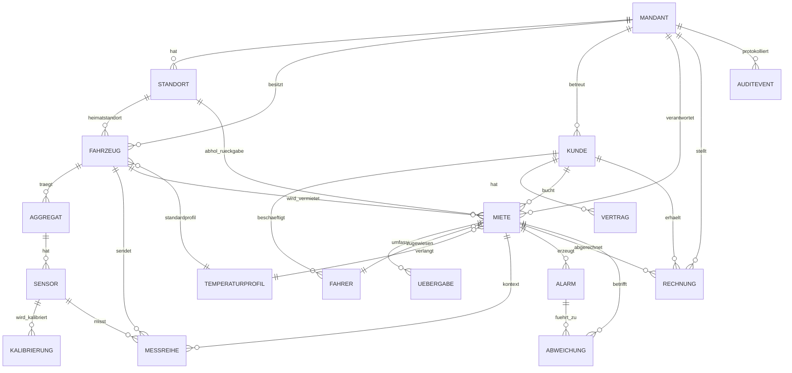
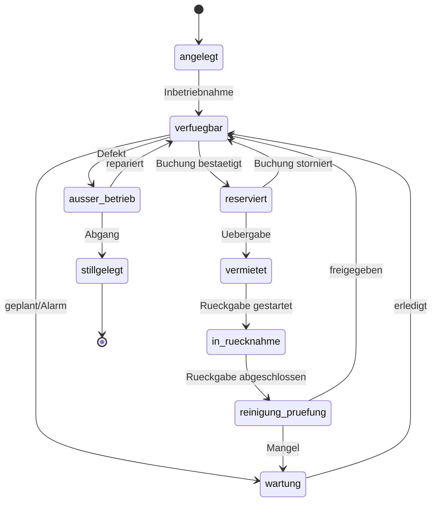
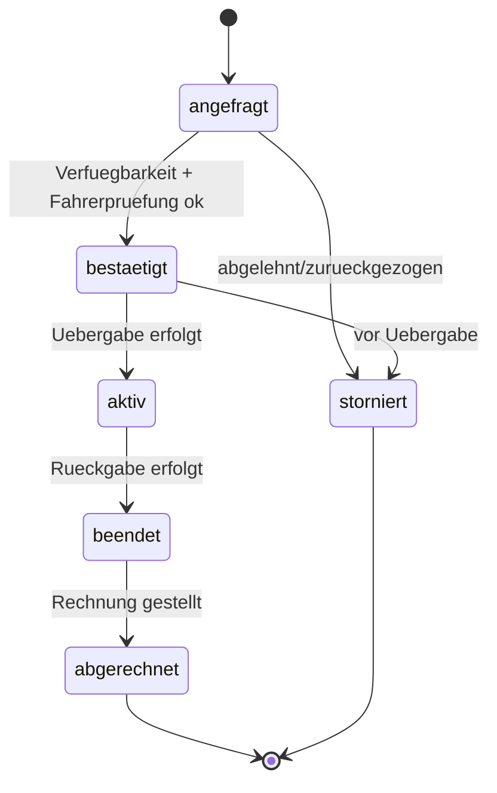
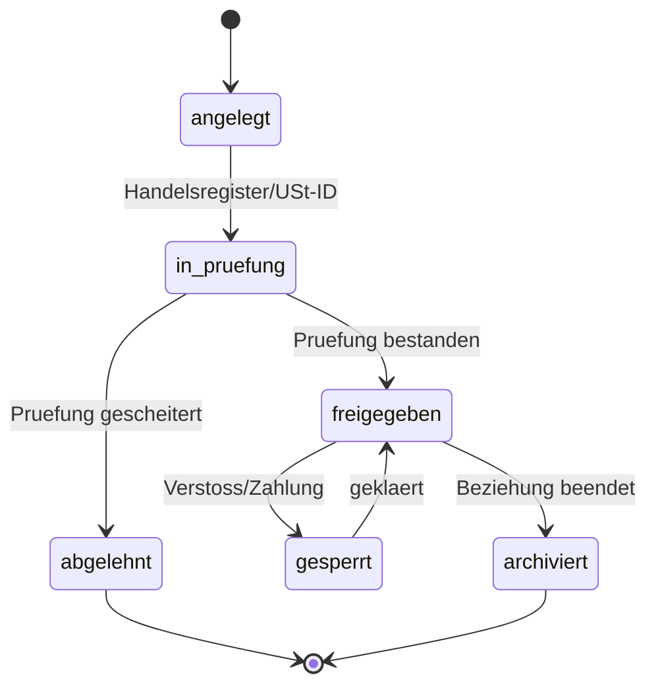
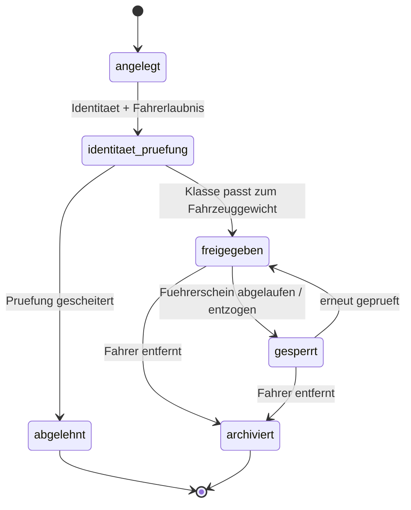
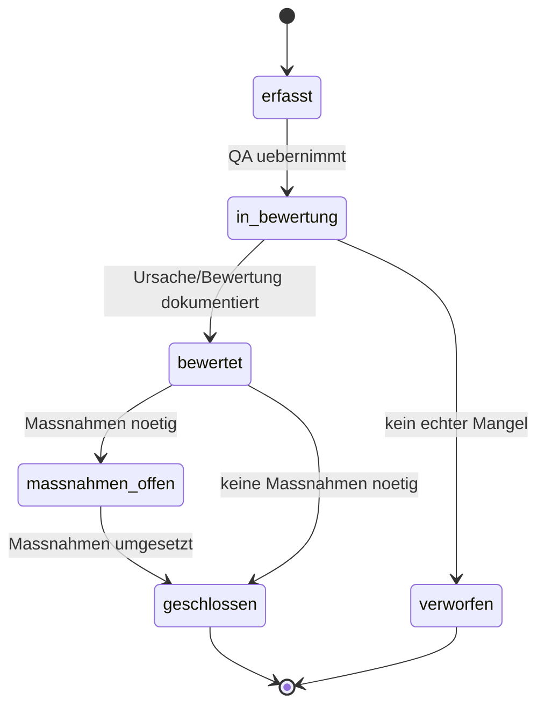

# Datenmodell v0 (Vorschlag)

**Status: Vorschlag (T-002, AP 0.4/0.6, R-06/R-11). Noch keine Migration.**
Dieser Entwurf geht an die Planung zur Prüfung. Erst nach Freigabe entstehen
Drizzle-Schema und versionierte Migrationen (siehe `CLAUDE.md`,
`DECISIONS.md` D-001). Offene Punkte stehen unten unter „Offene Fragen“ und
sind nach `STATUS.md` übernommen.

Dieses Dokument legt noch keine Feldtypen bis ins Detail fest; es beschreibt
Entitäten, Beziehungen, Statusmodelle, GDP-Relevanz, Mandant/Standort/Region
und das Mengengerüst bei 1.000 Mieten pro Tag (D-003).

---

## 1. Grundprinzipien (gelten für alle Entitäten)

1. **Mandant und Standort überall, wo sie hingehören (D-003, D-011).** Jeder
   fachliche Datensatz trägt `mandant_id`; standortbezogene Datensätze zusätzlich
   `standort_id`. Siehe Abschnitt 2 zur Bedeutung von „Mandant“ (offene Frage F-1).
2. **Audit Trail ab dem ersten Commit (CLAUDE.md, nicht verhandelbar).** Jede
   schreibende Aktion auf GDP-Daten erzeugt ein `AuditEvent` (wer, wann, was,
   alter und neuer Wert).
3. **Messwerte sind unveränderbar.** `Messreihe` und `AuditEvent` sind
   append-only: kein UPDATE, kein DELETE. Durchsetzung über Rechte und über
   `REVOKE`/Trigger auf DB-Ebene (Detail bei der Migration).
4. **Alle Zeitstempel in UTC** (`timestamptz`), Uhr synchronisiert.
5. **IDs kommen nicht aus der Anwendungslogik des Eingangs:** Telematik-
   Nachrichten bringen ihre eigene eindeutige `nachricht_id` mit
   (Duplikaterkennung, D-003/T-003). Interne Primärschlüssel sind UUID
   (v7 bevorzugt: zeitlich sortierbar, gut für Indizes).
6. **Soft-Delete statt echtem Löschen** bei fachlichen Stammdaten (Status
   `archiviert`), außer wo Datenschutz echtes Löschen verlangt (Fahrer, F-3).
   GDP-Nachweise werden nie gelöscht, nur über Aufbewahrungsfristen entsorgt.
7. **Dateien/Fotos nie in die DB** (D-003): In der DB stehen nur Referenzen
   (`*_ref`) auf Objekte im S3-Speicher.

**GDP-relevant** heißt in den Tabellen unten: Der Datensatz ist Teil des
lückenlosen, fälschungssicheren Temperatur-/Qualitätsnachweises oder seiner
Voraussetzungen (Kalibrierung, Übergabezustand, Abweichungen, Audit). Solche
Datensätze unterliegen strengerer Unveränderbarkeit und längeren Fristen.

---

## 2. Mandanten- und Standortmodell

- `mandant_id` bezeichnet den **Betreiber-Mandanten** (heute: Rent2Cool als
  einziger Betreiber; ein Platzhalter-Mandant). Das hält das Modell offen für
  mehrere Betreibergesellschaften/White-Label, ohne Umbau (D-003: „wächst über
  Konfiguration, nicht über Umbau“).
- Die **Datentrennung im Kundenportal** (nur Firmenkunden, D-010) läuft
  zusätzlich über `kunde_id`: Disposition und QA eines Kunden sehen nur
  Datensätze mit ihrer `kunde_id`. Die öffentliche Website hat keinen
  Schreibzugriff auf GDP-Daten (D-002).
- `region` (EU-Zone, D-003: Betrieb in mindestens zwei Zonen) wird als Attribut
  an den betriebsrelevanten Entitäten geführt (Standort, Fahrzeug, Miete), damit
  Auswertung und späterer Zonenbetrieb möglich sind. Werte sind Platzhalter, bis
  der Cloud-Anbieter feststeht (D-005/D-015). → offene Frage F-9.

> **F-1 (offen):** Ist „Mandant“ der Betreiber (wie hier vorgeschlagen) oder soll
> der Firmenkunde der Mandant sein? Das entscheidet, worauf `mandant_id` zeigt.

---

## 3. Überblick (ER-Diagramm)

Hinweis: `TEMPERATURPROFIL` steht nicht in der Entitätenliste der Aufgabe, ist
aber wegen D-008 (konfigurierbare Profile) nötig. Als Vorschlag markiert → F-4.

---

## 4. Entitäten im Detail

Spalten je Tabelle: wichtigste Felder · **GDP** (ja/nein) · Mandant/Standort ·
**Aufbewahrung** · **Menge @ 1.000 Mieten/Tag** · **Indizes/Partitionen**.

### 4.1 Mandant
- **Felder:** `id`, `name`, `aktiv`, `erstellt_am`.
- **GDP:** nein (Organisations-Metadaten).
- **Mandant/Standort:** ist selbst die Mandantenwurzel.
- **Aufbewahrung:** unbegrenzt (Stammdaten).
- **Menge:** ~1 (heute), Auslegung wenige.
- **Indizes:** PK `id`.

### 4.2 Standort (D-011)
- **Felder:** `id`, `mandant_id`, `name`, `adresse`, `geofence`
  (Mittelpunkt + Radius oder Polygon), `oeffnungsregeln`, `region`, `aktiv`.
  Platzhalter `PLACEHOLDER_HQ` (D-015).
- **GDP:** nein (aber betrieblich relevant für Übergabeort/Geofence).
- **Mandant/Standort:** `mandant_id`.
- **Aufbewahrung:** unbegrenzt (Stammdaten).
- **Menge:** wenige (Handvoll Standorte).
- **Indizes:** `mandant_id`; räumlicher Index auf `geofence` (PostGIS optional,
  → F-10).

### 4.3 Fahrzeug (D-007, D-012)
- **Felder:** `id`, `mandant_id`, `standort_id` (Heimatstandort), `region`,
  `kennzeichen`, `vin`, `fahrzeugprofil` (Platzhalter „Mercedes Kühltransporter
  bis 3,5 t“, D-015), `zul_gesamtmasse_kg` (Datum, nicht im Code, D-007),
  `benoetigte_fuehrerscheinklasse` (z. B. `B`, D-007), `hat_fahrtenschreiber`
  (D-006), `telematik_quelle` (Adapter-Kennung, D-012), `standard_temperaturprofil_id`,
  `status`.
- **GDP:** ja (Zustand/Kalibrierung des Assets ist Voraussetzung des Nachweises).
- **Mandant/Standort:** `mandant_id`, `standort_id`.
- **Aufbewahrung:** offen (mind. Lebensdauer + Nachweisfrist; F-2).
- **Menge:** 3.500–4.000.
- **Indizes:** `mandant_id`, `standort_id`, `status`, `kennzeichen` (unique),
  `hat_fahrtenschreiber` (Buchungsfilter D-006).

### 4.4 Aggregat (Kühlaufbau, D-012)
- **Felder:** `id`, `fahrzeug_id`, `typ`, `hersteller`, `seriennummer`,
  `eingebaut_am`, `ausgebaut_am` (für Historie wechselnder Aufbauten),
  `temperatur_quelle` (getrennt von Fahrzeugdaten, D-012/D-015).
- **GDP:** ja (Laderaumtemperatur stammt vom Aggregat, nicht vom Fahrzeug).
- **Mandant/Standort:** über `fahrzeug_id`.
- **Aufbewahrung:** offen (F-2).
- **Menge:** ~ Anzahl Fahrzeuge (plus Historie).
- **Indizes:** `fahrzeug_id`; ggf. Zeitraum (`eingebaut_am`, `ausgebaut_am`).
- **Hinweis:** Beziehung fest (1:1) oder wechselnd (1:n über Zeit)? → F-5.

### 4.5 Sensor (EN 12830, R-08/R-09)
- **Felder:** `id`, `aggregat_id` (bzw. `fahrzeug_id` für Positions-/Türsensoren),
  `messgroesse` (temperatur, position, tuer, …), `einheit`, `modell`,
  `seriennummer`, `aktiv`.
- **GDP:** ja (Messkette; Kalibrierpflicht).
- **Mandant/Standort:** über Aggregat/Fahrzeug.
- **Aufbewahrung:** offen (F-2).
- **Menge:** wenige je Fahrzeug → ~ einige 10.000.
- **Indizes:** `aggregat_id`, `fahrzeug_id`, `messgroesse`.

### 4.6 Kalibrierung (R-08/R-09)
- **Felder:** `id`, `sensor_id`, `durchgefuehrt_am`, `gueltig_bis`, `pruefstelle`,
  `zertifikat_ref` (S3), `ergebnis`, `erfasst_von`.
- **GDP:** ja (ohne gültige Kalibrierung ist der Messwert nicht beweiskräftig).
- **Mandant/Standort:** über Sensor.
- **Aufbewahrung:** lang, regulatorisch offen (F-2).
- **Menge:** Sensoren × wenige pro Jahr.
- **Indizes:** `sensor_id`, `gueltig_bis` (Fristenüberwachung: Sperre/Alarm bei
  Ablauf).

### 4.7 Kunde (Firmenkunde, D-010)
- **Felder:** `id`, `mandant_id`, `firmenname`, `handelsregisternummer`,
  `ust_id`, `rechnungsadresse`, `pruefstatus` (Handelsregister/USt-ID),
  `status`, `angelegt_am`.
- **GDP:** teilweise (Vertrags-/Qualitätsbezug; enthält Geschäfts-, kaum
  Personendaten — Ansprechpartner minimal halten).
- **Mandant/Standort:** `mandant_id` (und selbst Portal-Trenngrenze, Abschnitt 2).
- **Aufbewahrung:** offen (Handels-/Steuerrecht; F-2).
- **Menge:** wächst; Auslegung einige Tausend.
- **Indizes:** `mandant_id`, `ust_id`, `status`.

### 4.8 Fahrer (gehört zum Kunden, D-004/D-010/R-22)
- **Felder:** `id`, `kunde_id`, `name`, `fuehrerschein_klasse`,
  `fuehrerschein_nummer`, `fuehrerschein_gueltig_bis`, `identitaetspruefung_status`
  (Fake-Anbieter bis Auswahl, D-015), `status`, `letzte_pruefung_am`.
- **GDP:** nein im Sinne Kühlkette, **aber personenbezogen** (DSGVO):
  Datenminimierung, Löschkonzept nötig (F-3). Keine echten Personendaten, solange
  `dpo` Platzhalter ist (D-015).
- **Mandant/Standort:** über `kunde_id`.
- **Aufbewahrung:** möglichst kurz; Löschung nach Ende der Kundenbeziehung (F-3).
- **Menge:** mehrere je Kunde → ~ einige 10.000.
- **Indizes:** `kunde_id`, `status`, `fuehrerschein_gueltig_bis` (wiederkehrende
  Prüfung, Sperre bei Ablauf, R-22).

### 4.9 Vertrag (Rahmen + Qualitätsvereinbarung, R-01)
- **Felder:** `id`, `kunde_id`, `typ` (rahmenvertrag, qualitaetsvereinbarung),
  `gueltig_ab`, `gueltig_bis`, `dokument_ref` (S3), `status`,
  `unterzeichnet_am`.
- **GDP:** ja (Qualitätsvereinbarung begründet die Rollenverteilung D-004).
- **Mandant/Standort:** über `kunde_id`.
- **Aufbewahrung:** Vertrags-/GDP-Frist, offen (F-2).
- **Menge:** ~ Anzahl Kunden (× Vertragstypen).
- **Indizes:** `kunde_id`, `typ`, `status`, `gueltig_bis`.

### 4.10 Miete (D-009)
- **Felder:** `id`, `mandant_id`, `kunde_id`, `fahrzeug_id`, `fahrer_id`,
  `standort_abhol_id`, `standort_rueckgabe_id`, `region`, `start_geplant`,
  `ende_geplant`, `start_ist`, `ende_ist`, `tarif`, `auslandsfahrt_geplant`
  (Buchungsregel D-006), `temperaturprofil_id`, `status`, `idempotency_key`
  (idempotente Buchung, D-003), `erstellt_am`.
- **GDP:** ja (Rahmen jedes Temperaturnachweises).
- **Mandant/Standort:** `mandant_id`, beide Standorte.
- **Aufbewahrung:** GDP-Frist, offen (F-2).
- **Menge:** **1.000/Tag → ~365.000/Jahr.**
- **Indizes:** `mandant_id`, `kunde_id`, `fahrzeug_id`, `status`, `start_geplant`;
  `idempotency_key` (unique je Mandant). **Partition:** nach `start_geplant`
  (monatlich), sobald Historie wächst — deklarative Partitionierung oder
  TimescaleDB-Hypertable (→ F-7-nah, Detail bei Migration).

### 4.11 Übergabe (Übergabe/Rücknahme, D-014)
- **Felder:** `id`, `miete_id`, `typ` (uebergabe, ruecknahme), `zeitpunkt`,
  `fahrer_id`, `standort_id`, `geofence_ok`, `foto_refs` (S3-Liste),
  `checkliste` (jsonb; Reinigungs-/Zustandscheck), `schluessel_ereignis_ref`
  (KeyProvider-Simulator bis Entscheid, D-015), `zustand`.
- **GDP:** ja (Zustand/Fotobeleg bei Übergabe und Rücknahme).
- **Mandant/Standort:** über `miete_id`; `standort_id`.
- **Aufbewahrung:** GDP-Frist, offen (F-2).
- **Menge:** 2 je Miete → **~2.000/Tag.**
- **Indizes:** `miete_id`, `typ`, `zeitpunkt`.

### 4.12 Messreihe (Zeitreihe — die große Tabelle)
- **Felder:** `zeit` (timestamptz, UTC), `fahrzeug_id`, `sensor_id`,
  `miete_id` (nullable: nur wenn gerade vermietet), `messgroesse`, `wert`,
  `einheit`, `nachricht_id` (Duplikaterkennung), `quelle` (Adapter),
  `empfangen_am`.
- **GDP:** ja (der eigentliche Nachweis). **Append-only, unveränderbar.**
- **Mandant/Standort:** über `fahrzeug_id` (Mandant) / `miete_id`.
- **Aufbewahrung:** lang, regulatorisch offen (F-2); Kompression nach wenigen
  Tagen, Entsorgung erst nach Fristende.
- **Menge:** ~5,76 Mio. Nachrichten/Tag × ~10 Werte ≈ **~58 Mio. Wertezeilen/Tag**
  (~21 Mrd./Jahr). Dominierende Datenmenge (D-003).
- **Indizes/Partition:** **TimescaleDB-Hypertable**, Zeit-Chunks (täglich),
  Kompression älterer Chunks (erwartet ≥10×), Retention-Policy; Index
  `(fahrzeug_id, zeit DESC)` und `(miete_id, zeit)`; **nie unbegrenzte Abfrage
  über alle Messwerte** (D-003) — immer Zeit-/Fahrzeug-/Mietenfilter + Pagination.
- **Dedup:** über `nachricht_id` (Detail T-003) → F-6.

### 4.13 Alarm
- **Felder:** `id`, `fahrzeug_id`, `miete_id` (nullable), `sensor_id` (nullable),
  `typ` (temperatur_ueber, temperatur_unter, tuer_offen, funkloch,
  grenzuebertritt_ohne_tacho [D-006], kalibrierung_abgelaufen, …),
  `ausgeloest_am`, `schwelle`, `wert`, `status`, `quittiert_von`, `quittiert_am`.
- **GDP:** ja (Abweichungen von Temperaturgrenzen).
- **Mandant/Standort:** über Fahrzeug/Miete.
- **Aufbewahrung:** GDP-Frist, offen (F-2).
- **Menge:** stark lastabhängig; Auslegung: mehrere Tausend/Tag möglich → F-8
  (ggf. ebenfalls zeit-partitioniert).
- **Indizes:** `miete_id`, `status`, `ausgeloest_am`, `typ`.

### 4.14 Abweichung (GDP-Abweichung/CAPA)
- **Felder:** `id`, `mandant_id`, `bezug_typ` (miete, fahrzeug, alarm),
  `bezug_id`, `beschreibung`, `schweregrad`, `status`, `bewertung`,
  `massnahmen`, `verantwortlich` (`qa_approver`, D-015), `erfasst_am`,
  `geschlossen_am`.
- **GDP:** ja (Kern des Qualitätsmanagements).
- **Mandant/Standort:** `mandant_id`; über Bezug.
- **Aufbewahrung:** lang, regulatorisch offen (F-2).
- **Menge:** niedrig (im Verhältnis).
- **Indizes:** `(bezug_typ, bezug_id)`, `status`, `erfasst_am`.

### 4.15 Rechnung (R-63)
- **Felder:** `id`, `mandant_id`, `kunde_id`, `rechnungsnummer` (fortlaufend),
  `zeitraum`, `positionen` (Bezug auf Miete(n)), `netto`, `steuer`, `brutto`,
  `status`, `gestellt_am`, `bezahlt_am`.
- **GDP:** nein (kaufmännisch), aber eigene **steuerliche** Aufbewahrung
  (vmtl. 10 Jahre DE — vom Steuerberater bestätigen, R-63/F-2).
- **Mandant/Standort:** `mandant_id`.
- **Aufbewahrung:** steuerlich (F-2).
- **Menge:** ~ Mieten oder Sammelrechnungen (F-7).
- **Indizes:** `kunde_id`, `rechnungsnummer` (unique), `status`, `zeitraum`.

### 4.16 AuditEvent (Audit Trail — nicht verhandelbar)
- **Felder:** `id`, `zeit` (UTC), `akteur_id`, `akteur_rolle`, `aktion`
  (create/update/delete/login/freigabe/…), `entitaet_typ`, `entitaet_id`,
  `alt_wert` (jsonb), `neu_wert` (jsonb), `mandant_id`, `quelle` (admin/app/
  portal/system).
- **GDP:** ja. **Append-only, unveränderbar.**
- **Mandant/Standort:** `mandant_id`.
- **Aufbewahrung:** lang, regulatorisch offen (F-2).
- **Menge:** jede schreibende Aktion → zehntausende/Tag; wächst mit Betrieb.
- **Indizes/Partition:** zeit-partitioniert (Hypertable/Partition); Index
  `(entitaet_typ, entitaet_id, zeit)`, `(akteur_id, zeit)`, `zeit`.

### 4.17 Temperaturprofil (zusätzlich vorgeschlagen, D-008)
- **Felder:** `id`, `mandant_id`, `name`, `min_c`, `max_c`, `alarmregeln`
  (jsonb: Dauer/Hysterese), `aktiv`. Start: „2–8 °C“ und „15–25 °C“.
- **GDP:** ja (definiert die Grenzwerte des Nachweises).
- **Aufbewahrung:** unbegrenzt / versioniert (Historie der Grenzwerte).
- **Menge:** sehr wenige.
- **Indizes:** `mandant_id`. **Hinweis:** nicht in der Vorgabeliste → F-4.

---

## 5. Statusmodelle (erlaubte Übergänge)

### 5.1 Fahrzeug

### 5.2 Miete

Regel zu D-006: Übergang `angefragt --> bestaetigt` nur möglich, wenn bei
`auslandsfahrt_geplant = true` ein Fahrzeug mit `hat_fahrtenschreiber = true`
gewählt ist, und wenn der zugewiesene Fahrer gültig geprüft ist (R-22).

### 5.3 Kunde

### 5.4 Fahrer (R-22)

### 5.5 Abweichung

Alle Statusübergänge sind GDP-relevant und erzeugen ein `AuditEvent` (Akteur,
Zeit, alt/neu). Freigaben (Abweichung, Fahrer) nach Vier-Augen-Prinzip (D-015).

---

## 6. Mengengerüst-Zusammenfassung (@ 1.000 Mieten/Tag, D-003)

| Entität | Menge pro Tag | Kumuliert/Jahr | Besonderheit |
|---|---|---|---|
| Messreihe (Werte) | ~58 Mio. | ~21 Mrd. | Hypertable, Kompression, Retention |
| Telematik-Nachrichten | ~5,76 Mio. | — | Dedup über `nachricht_id` |
| AuditEvent | 10⁴–10⁵ | wächst stark | zeit-partitioniert |
| Alarm | 10³–10⁴ (lastabh.) | — | ggf. zeit-partitioniert (F-8) |
| Übergabe | ~2.000 | ~730.000 | Fotos nur als S3-Ref |
| Miete | 1.000 | ~365.000 | Partition nach `start_geplant` |
| Rechnung | ~1.000 (F-7) | ~365.000 | steuerliche Frist |
| Fahrzeug | — | 3.500–4.000 gesamt | Stammdaten |
| Fahrer | — | ~10.000+ gesamt | personenbezogen (F-3) |
| Kunde | — | einige Tausend | Stammdaten |

Fotos/Dateien (~120 GB/Tag, D-003) liegen im Objektspeicher (S3), nicht in der
DB; die DB hält nur Referenzen.

---

## 7. Offene Fragen (an die Planung)

- **F-1 Mandantenbegriff:** `mandant_id` = Betreiber (Vorschlag) oder = Firmenkunde?
- **F-2 Aufbewahrungsfristen:** Welche Fristen gelten für GDP-Nachweise
  (Messreihe, Kalibrierung, Übergabe, Alarm, Abweichung, AuditEvent) und für
  Rechnungen (Steuerrecht)? Quelle: Regulatorik-Register/Steuerberater (R-63).
- **F-3 Fahrer-Personendaten:** Welche Fahrerdaten dürfen wie lange gespeichert
  werden (Datenminimierung), und wann/wie wird gelöscht? Abhängig vom DSB
  (D-015-Platzhalter `dpo`).
- **F-4 Temperaturprofil** als eigene Entität ok (nötig wegen D-008), oder anders
  modellieren?
- **F-5 Aggregat ↔ Fahrzeug:** fest verbaut (1:1) oder wechselnder Aufbau mit
  Historie (1:n über Zeit)? Beeinflusst die Zuordnung der Laderaumtemperatur.
- **F-6 Messreihe-Dedup:** `nachricht_id` eindeutig pro Nachricht — separater
  Dedup-Ledger oder Unique-Constraint auf `(nachricht_id, messgroesse)`? (Detail
  in T-003, Modell betroffen.)
- **F-7 Rechnung ↔ Miete:** 1:1 je Miete oder Sammelrechnung (n Mieten je
  Rechnung)? Hängt am Tarif-/Abrechnungsmodell.
- **F-8 Alarm-Volumen:** Erwartete Alarmrate — reicht eine normale Tabelle oder
  ebenfalls Zeit-Partitionierung?
- **F-9 Region/EU-Zonen (D-003):** `region` als Attribut je Datensatz (Vorschlag)
  vs. getrennte DB je Zone — Architekturfrage vor Phase 2.
- **F-10 Geofence/PostGIS:** Geofence als einfacher Kreis (Mittelpunkt+Radius) oder
  PostGIS-Polygon mit räumlichem Index?
